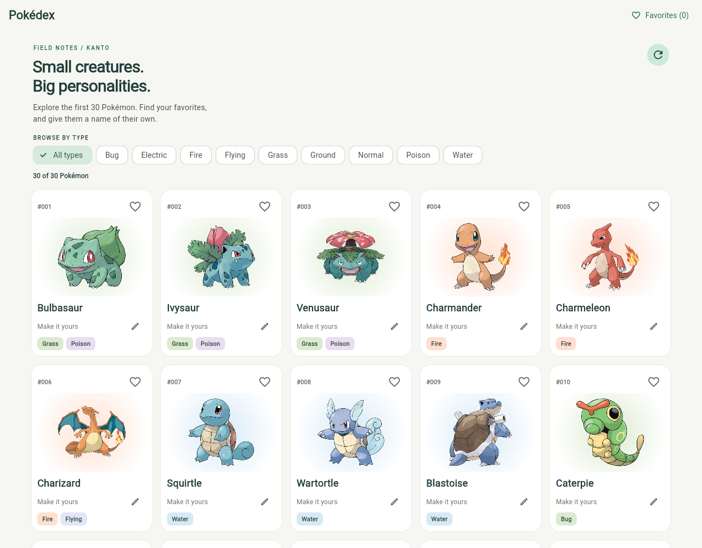

# Pokédex · Field Notes

**CS Elective 2 — Flutter Midterm**

A responsive Pokédex with personal nicknames, a shared retractable favorites panel,
and filtering based on real Pokémon type data. **Riverpod is the only application
state-management approach.**

## Submission branch

[Open `midterm-exam`](https://github.com/edmcorpuz/edmcorpuz-Corpuz-CS-Elective-2/tree/midterm-exam)

This branch continues the latest Pokédex activity, `state-mgt-act`, at
`71141a32ce6efbbae152c0cb824dcede0e6619cc`. It migrates the previous Provider
implementation rather than replacing the repository with an unrelated project.
The previous activity branches and `main` are unchanged.

The original requirements are preserved in [docs/ASSIGNMENT.md](docs/ASSIGNMENT.md).



[Phone layout](docs/images/mobile.png)

## The five required features

| Requirement | Implementation |
| --- | --- |
| List management | `PokedexController.fetchPokemon()` owns loading, success, and error state. Startup, the home refresh button, pull-to-refresh, and retry all call this **same** method. There is no separate `refresh()` action. |
| Nickname editor | Add, edit, validate, cancel, or remove a nickname through a dialog. Nicknames are stored by Pokémon ID in Riverpod and update the card, detail page, and favorites panel immediately. Original names remain visible. |
| Favorites panel | One expandable/collapsible panel is available in the app bar on **both home and detail pages**. It has an empty state and lets users open or remove favorites. Expansion state survives route navigation. |
| Heart indicator | Every Pokémon card has a real favorite toggle. Filled/outlined hearts, the panel, and its count all react to the same ID set. Details have the same toggle. |
| Type filter | Chips are derived from actual `types` returned by PokéAPI. Dual-type Pokémon match either type. **All types** clears the filter. Filtering does not change the favorites panel or delete nicknames. |

Extras include real height/weight/base stats on the detail page, accessible button
labels, image-loading/error fallbacks, and responsive layouts with large-text
support. No secret API key or account is required.

## Run in VS Code

Prerequisites: Flutter **3.44.8** (includes Dart **3.12.2**), Chrome, and the
recommended Dart/Flutter VS Code extensions. The SDK is pinned in `.mise.toml`.
Use **mise** to install/manage the SDK; do not manually edit PATH.

```sh
mise install
mise exec -- flutter pub get
mise exec -- flutter run -d chrome
```

On Windows, if your shell cannot directly launch Flutter's batch wrapper:

```powershell
mise exec -- cmd /c flutter pub get
mise exec -- cmd /c flutter run -d chrome
```

Open this repository folder in VS Code. Select **Pokédex (Chrome)** in Run and
Debug and press **F5**. A selected-device launch configuration is also included.
If the extension asks for an SDK, choose the installed SDK reported by
`mise where flutter`; do not commit a machine-specific SDK path.

An Android emulator/device also requires Android SDK setup and accepted licenses.
Android internet permission is already included. **The development computer has
no Android SDK or Windows native C++ toolchain**, so the native Android/Windows
builds were not verified. Web release and real Chrome execution were verified.
iOS/macOS builds were not run on this Windows host.

## API and dataset

The data source and list endpoint from the existing activity are retained:

```text
https://pokeapi.co/api/v2/pokemon?limit=30&offset=0
```

- The collection is the **first 30 Pokémon**, not the entire Pokédex.
- The list response has no type information, so the service fetches
  `/api/v2/pokemon/{id}` details, **at most six requests concurrently**.
- A normal fetch uses one list request plus 30 detail requests. Artwork requests
  are separate. Each HTTP request has a 15-second timeout.
- Types, dimensions, and stats are parsed from the API. The small type-to-color
  map only controls presentation; it does not determine Pokémon types.
- The live first-30 dataset currently offers nine types: Bug, Electric, Fire,
  Flying, Grass, Ground, Normal, Poison, and Water.
- Artwork remains the official-artwork sprite source used in the prior activity.

## State and data flow

```text
ProviderScope
  ├── pokemonServiceProvider → HTTP client + parsing + lifecycle cleanup
  └── pokedexProvider: NotifierProvider<PokedexController, PokedexState>
        ├── Pokémon list + load status + readable error
        ├── favorite IDs + nickname map
        └── selected type + favorites-panel expansion

UI event → ref.read(pokedexProvider.notifier).method()
              → immutable replacement of state
              → ref.watch(...) → subscribed UI rebuilds
```

`PokedexState` has immutable lists/maps/sets and derived getters for visible
Pokémon, favorites, and available types. The type filter never mutates the
source list. Favorite and nickname identity is based on stable Pokémon IDs.

The controller uses Riverpod's modern `Notifier`, not `ChangeNotifier`, legacy
`StateNotifier`, BLoC, or a second global-state system. An explicit load-status
field lets a refresh display progress without throwing away the last successful
collection. A failed refresh preserves that collection and its personalizations.
An initial failure instead shows a full error/retry state.

Concurrent refreshes share one in-flight Future. Async completion copies the
**current** state so edits made during loading are not overwritten. `ref.mounted`
prevents writes after disposal; `ref.onDispose` closes the HTTP client.

The detail route carries only an ID and resolves its model from Riverpod. This
keeps stacked detail routes correct when opening another favorite and then going
back. The nickname dialog owns only a temporary text controller and Form, and
disposes the controller when closed. Saving/removing changes shared Riverpod state.

## Important scope boundaries

- **Nicknames and favorites are session-only app state**, as required. They survive
  page navigation, filtering, and in-app data refresh. They do **not** survive a
  full app restart/browser reload. There is no database or persistent settings store.
- Internet access is required for first load and artwork. Keeping an already-loaded
  list after a failed refresh is **not** persistent offline caching.
- If a later response no longer contains an ID, it is not shown as a ghost favorite.
  Its saved in-session metadata can be reused if that ID reappears.
- An empty API response and a nonempty collection with zero filter matches have
  distinct messages. Clearing the type filter restores the loaded collection.
- No Provider package imports, `ChangeNotifierProvider`, or BLoC implementation
  remain. `flutter_riverpod` supplies the Riverpod ecosystem transitively.

## Files to inspect

```text
lib/
  main.dart                         ProviderScope, MaterialApp, visual theme
  models/pokemon.dart               Immutable API model and JSON validation
  providers/pokedex_state.dart      Immutable state and derived collections
  providers/pokedex_provider.dart   Riverpod providers and all state actions
  services/pokemon_service.dart     HTTP, batching, parsing, readable failures
  screens/pokedex_screen.dart       Refreshable home, type chips, list states
  screens/pokemon_detail_screen.dart Shared-state detail, nickname, dimensions/stats
  widgets/pokedex_shell.dart        Shared app bar and retractable favorites
  widgets/favorite_button.dart      Reactive heart toggle
  widgets/nickname_editor.dart      Form, validation, save/remove, cleanup
  widgets/pokemon_card.dart         Original name, nickname, image, heart, types
  widgets/pokemon_grid.dart         Responsive sliver grid
  widgets/pokemon_image.dart        Network image, loading/error fallback
  widgets/pokedex_status.dart       Reusable error/empty states
  widgets/type_badge.dart           Display-only type colors and labels

test/                               Service, model, Riverpod, widget tests
tool/verify_live_api.dart            Optional real-PokéAPI integration check
docs/ASSIGNMENT.md                   Original assignment
docs/VERIFICATION.md                 Actual verification results and limits
```

## Verify

```sh
mise exec -- dart format --output=none --set-exit-if-changed lib test tool
mise exec -- flutter analyze
mise exec -- flutter test
mise exec -- flutter build web
mise exec -- dart run tool/verify_live_api.dart
```

Use `mise exec -- cmd /c ...` for these commands on Windows if needed. The unit and
widget tests use injected service/mock HTTP data and do not require a working
PokéAPI connection. The final command intentionally calls the real API.

**Verified:** 44 automated tests passed; static analysis clean; production web
build succeeded; live API returned all 30 Pokémon with real types; the release
ran in Chrome at desktop and phone sizes. See [verification details](docs/VERIFICATION.md).

Pokémon names/artwork belong to their respective owners. Data is provided by
[PokéAPI](https://pokeapi.co/); this is an educational, noncommercial project.
